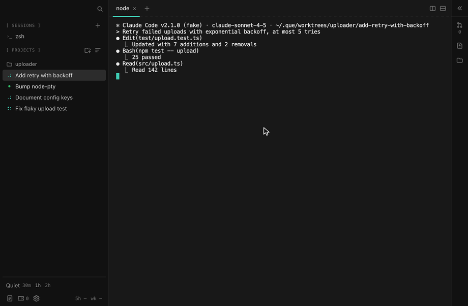

# que

**Focus when you need it. Your agents keep working.**



Coding agents made the work faster, and every tool built around them gives you
more: more sessions, more parallel tasks, more panes, more pings. None of them
helps you stop looking. You start a session before dinner and check it from the
couch. You run three during a meeting and watch them instead of the meeting. At
one in the morning one of them asks a question, and you answer it.

que is a macOS app for running Claude Code sessions in git worktrees that also
puts a boundary around them. Choose your hours, or start a quiet hour before a
meeting, and que goes quiet. Your sessions keep running in their own branches.
The window shrinks to the one question that matters while you're away: **is it
running, and is it stuck?** Terminals, diffs and reports stay hidden until the
quiet ends. You can still look: an unlock lasts a few minutes, then quiet comes
back on its own, and every unlock shows up in the morning report.

It works like putting your phone in a box by the door. Nothing is out of reach;
reaching for it is a decision now, not a reflex.

## A day with que

**At work.** Every task gets its own workspace: a git worktree on its own
branch, with your repo's setup run inside it. Sessions live in a background
daemon, so closing the window, or quitting the app, ends nothing. The sidebar
shows each session as working, idle, needs input or stuck, and a chime tells you
when one finishes. A review pane at the right shows what a workspace changed,
its files, and its pull request with checks and comments.

**When you go quiet.** At the hours you set (19:00 to 07:00 by default), or when
you click **Quiet** for 30 minutes, an hour or two before a meeting or a shared
screen, the terminals give way to the quiet board: a dim row per session and a
count of what is running, waiting and stuck. Nothing on it asks for your
attention. A session that needs an answer says `waiting` and waits, with no
badge and no sound. The daemon enforces it: terminal contents, reports and new
work are refused to every client, the `que` CLI included, so there is no side
door.

**When you really need to look.** Click Unlock on the board, or run
`que unlock 15 --why "deploy check"` to note why. Everything comes back for a
while (20 minutes by default), then it goes quiet again by itself. `que lock`
ends it early.

**In the morning.** The report says what the night did: each session's time
working, the questions it asked, its commits and pull request, what is waiting
for you, and every unlock with its time and length. You start the day knowing
where things are, not scrolling back through terminals to find out.

## What you get

- **Workspaces**: one git worktree per task, with per-repo setup and teardown
  from `que.toml`.
- **Terminals that outlive the app**: quit and relaunch, and every screen comes
  back; sessions even resume after the daemon itself restarts.
- **Live status** for every session, from Claude Code hooks that que passes per
  session. Your own settings are never edited.
- **Review without leaving**: diffs, the workspace's files, and its pull request
  with checks and conversation, side by side with the terminals.
- **Quiet hours and on-demand quiet**: enforced by the daemon, with a board that
  shows counts and dots only, and unlocks that are time-boxed and logged.
- **A morning report**, in the app or with `que report`.
- **A CLI** for everything the app does, and a menu-bar title (`● 3 ▸ 1 ✕ 0`).
- **Local**: no account and no server. The terminals, the state and the logs
  stay on your Mac.

## Install

que is in early preview (0.x): used every day by its author, changing fast.

Download the latest `que-<version>-arm64.dmg` from
[Releases](https://github.com/rquellh/que/releases) and drag que to
Applications. It needs macOS on Apple Silicon. Prereleases (`-beta.N`) appear on
the same page for anyone who wants the newest build early; the app only offers
you stable releases.

Builds are not signed yet, so macOS blocks the first launch. Open it anyway from
**System Settings → Privacy & Security → Open Anyway**, or clear the quarantine
flag:

```sh
xattr -dr com.apple.quarantine /Applications/que.app
```

Then choose **que → Install 'que' command in PATH** to get the CLI. It links into
`/usr/local/bin` when that is writable and `~/.local/bin` otherwise.

You also need Claude Code (`claude`) and git on your PATH. With `gh` installed
and logged in, que shows each workspace's pull request.

## First run

```sh
que doctor                     # checks the daemon, claude, gh, git, config, hooks
que project add ~/code/uploader
que work "Add retry logic" -r ~/code/uploader --name app-142-retry   # a worktree on branch app-142-retry
que attach app-142-retry       # or click it in the app's sidebar
claude                         # in the workspace terminal; its status shows in the sidebar
```

Then set your hours, or keep the defaults:

```sh
que config set quiet_hours.default=19:00,07:00
que quiet start 45             # or go quiet now, for 45 minutes
```

## Before bed

A session you start in the evening keeps going after you close the window,
since its terminal lives in the daemon:

```sh
que work "Add retry with backoff to the uploader" -r ~/code/uploader
que attach <workspace>         # start claude on it, then close the window
que report                     # in the morning: what the sessions did, what needs a look
```

It works in its own worktree and branch. When it needs an answer it stops and
waits in its tab, marked needs input, until you come back. In the morning
`que report` (or the app's report view) lists each session: what it did, its
commits ahead, its pull request, and whether it is waiting for you.
`notifications.morning_summary` adds a notification when quiet hours end.
Sessions open their own pull requests with `gh pr create`; the app's review
pane picks them up, with their checks and comments.

## Quiet mode, in detail

From 19:00 to 07:00 by default, the app swaps its terminals for the quiet board:
a dim line of what is running, waiting, stuck and idle, a row for each, and
nothing to click but Unlock. The daemon refuses terminal contents, reports and
new work to every client during those hours, so the CLI cannot peek either.
`que unlock 15 --why "deploy check"` (or the board's button) shows everything for
a while; `que lock` ends it early. When the window ends, `que report` (or the
app's report view) shows what the night did, unlocks included;
`notifications.morning_summary` adds a notification. Set different hours per day
of the week, or none on a given night, in the configuration below.

`que quiet start 45` goes quiet the same way for 45 minutes (default 60, at most
720), for a meeting or a shared screen, whether or not quiet hours are on; the
sidebar's **Quiet** row and the menu-bar menu do the same in a click, and
`que quiet end` ends it early. Unlocking inside it works as at night, and those
daytime unlocks stay out of the night's unlock log. A manual quiet never ends
scheduled quiet hours early.

## Configuration

`~/.config/que/config.toml` (or `$QUE_CONFIG`); `que config set key=value` edits
it and the daemon reloads at once. Every key, with its default
([details](docs/configuration.md)):

<!-- generated:config-defaults -->

```toml
# ~/.config/que/config.toml (or $QUE_CONFIG). Every key is optional;
# these are the defaults.
worktree_root = "~/.que/worktrees"
stall_timeout_minutes = 5
teardown_timeout_seconds = 60
status_poll_seconds = 10
pr_poll_seconds = 60
# default_permission_mode = "acceptEdits"   # unset: que.toml or Claude Code decides
allow_bypass_permissions = false
protected_branches = ["main", "master", "release"]
start_prompt = "" # empty: Claude starts on the brief itself
# instructions_file = "~/.config/que/instructions.md"   # unset: no instructions

[quiet_hours]
enabled = true
default = ["19:00", "07:00"]
unlock_minutes = 20
# friday = ["21:00", "09:00"]   # a per-day override (sunday … saturday)
# saturday = "none"             # no quiet hours that night

[notifications]
chime_on_complete = true
chime_on_needs_input = false
chime_in_manual_quiet = false
morning_summary = false

[jira]
jql = "assignee = currentUser() AND statusCategory != Done ORDER BY updated DESC"
poll_minutes = 5
start_prompt = "Read .que/ticket.md, the ticket this workspace is for. Restate the goal in a sentence, look at the code it touches, and propose a plan before changing anything."
# [jira.projects]                # learned the first time you pick a project for a ticket
# APP = "uploader"               # tracker project key = que project name

# [repos.uploader]               # a name for `que work -r uploader`
# path = "~/code/uploader"
# default_branch = "main"
```

<!-- /generated -->

Per repository, `que.toml` at the repo root (none of these keys has a default):

<!-- generated:repo-example -->

```toml
# <repo>/que.toml. Every key is optional; none has a default.
setup = "npm ci" # run inside a new worktree
teardown = "./scripts/teardown.sh" # run inside a worktree before removal
default_branch = "main" # base for new workspaces (else origin's HEAD)
worktree_include = [".env.local"] # gitignored files copied into new worktrees
permission_mode = "acceptEdits" # default | acceptEdits | plan | bypassPermissions | dontAsk | auto
```

<!-- /generated -->

## CLI

Generated from `que --help`; options and arguments are in [docs/cli.md](docs/cli.md).

<!-- generated:cli-table -->

| Command                                     | What it does                                                                                                                                                                               |
| ------------------------------------------- | ------------------------------------------------------------------------------------------------------------------------------------------------------------------------------------------ |
| `que daemon start [options]`                | start the daemon if it is not running                                                                                                                                                      |
| `que daemon stop [options]`                 | kill all terminals and stop the daemon                                                                                                                                                     |
| `que daemon restart [options]`              | stop the daemon, ending every terminal, and start it from this build                                                                                                                       |
| `que daemon status [options]`               | show whether the daemon is running                                                                                                                                                         |
| `que daemon upgrade [options]`              | hand every terminal to the daemon of this que, without ending any                                                                                                                          |
| `que daemon install [options]`              | install a launchd agent that keeps the daemon running                                                                                                                                      |
| `que daemon uninstall [options]`            | remove the launchd agent                                                                                                                                                                   |
| `que term list [options]`                   | list terminals                                                                                                                                                                             |
| `que term new [options]`                    | create a terminal running a login shell                                                                                                                                                    |
| `que term snapshot [options] <id>`          | print the terminal screen and scrollback                                                                                                                                                   |
| `que term kill [options] <id>`              | kill a terminal                                                                                                                                                                            |
| `que term attach [options] <id>`            | attach this TTY to a terminal (Ctrl-] detaches)                                                                                                                                            |
| `que project add [options] <path>`          | register a git repository                                                                                                                                                                  |
| `que project list [options]`                | list projects                                                                                                                                                                              |
| `que work [options] [brief]`                | create a workspace (git worktree) from a brief and print its path; the first line of the brief is its title, and its branch and folder get a random three-word name unless --name is given |
| `que ws list [options]`                     | list workspaces                                                                                                                                                                            |
| `que ws remove [options] <workspace>`       | remove a workspace: kill its terminals, run teardown, remove the worktree and delete its branch                                                                                            |
| `que ws diff [options] <workspace>`         | what a workspace changed against its base, committed and uncommitted, with its commits                                                                                                     |
| `que ws files [options] <workspace>`        | every file of a workspace's worktree, tracked and untracked, never ignored                                                                                                                 |
| `que ws pr [options] <workspace>`           | a workspace's pull request: its checks and its conversation                                                                                                                                |
| `que ws terminal [options] <workspace>`     | print the id of the workspace's latest live terminal, opening one if needed                                                                                                                |
| `que status [options]`                      | summary and per-workspace status                                                                                                                                                           |
| `que attach [options] <workspace>`          | attach to the workspace's latest terminal, opening one if needed (Ctrl-] detaches)                                                                                                         |
| `que open [options] <workspace>`            | open the workspace with `code -n`                                                                                                                                                          |
| `que tickets list [options]`                | list the cached tickets (the default)                                                                                                                                                      |
| `que tickets sync [options]`                | fetch the queue from the tracker now                                                                                                                                                       |
| `que tickets start [options] <key>`         | make a workspace for a ticket, write it as a brief, and start claude on it                                                                                                                 |
| `que tickets open [options] <key>`          | open a ticket's page in the browser                                                                                                                                                        |
| `que unlock [options] [minutes]`            | unlock detail during quiet hours for a while (default: quiet_hours.unlock_minutes)                                                                                                         |
| `que lock [options]`                        | end an unlock early                                                                                                                                                                        |
| `que quiet status [options]`                | whether quiet hours are on, until when, and any unlock                                                                                                                                     |
| `que quiet start [options] [minutes]`       | go quiet now, as in quiet hours, for a while (default 60 minutes, at most 720)                                                                                                             |
| `que quiet end [options]`                   | end a manual quiet early                                                                                                                                                                   |
| `que config get [options]`                  | print the config file path and the parsed config                                                                                                                                           |
| `que config set [options] <assignments...>` | set keys (dotted, e.g. quiet_hours.default=19:00,07:00) and reload the daemon                                                                                                              |
| `que report [options]`                      | the morning report: what the sessions did                                                                                                                                                  |
| `que usage [options]`                       | Claude plan usage: the five-hour and weekly windows, from the sessions' status line                                                                                                        |
| `que hook [options]`                        | report a Claude Code hook event (stdin JSON) to the daemon; used by hooks.json                                                                                                             |
| `que statusline [options]`                  | report Claude plan usage (status line JSON on stdin) to the daemon, then run your own status line; used by hooks.json                                                                      |
| `que doctor [options]`                      | check the daemon, claude, gh, git, node, config, and the hooks wrapper                                                                                                                     |

<!-- /generated -->

## Development

```sh
npm ci            # Node 24; also prepares node-pty for Electron
npm run dev       # the app with hot reload
npm run verify    # typecheck, lint, build, vitest, smoke, playwright; stops at the first failure
npm run package   # an unsigned que.app in release/mac-arm64
npm run dist      # the DMG and zip
```

### Running from source

```sh
npm run install:local
```

Builds que.app from your checkout, replaces `/Applications/que.app` with it, links the `que`
command (`/usr/local/bin/que` when that is writable, else `~/.local/bin/que`), and reopens the
app. It never touches the background service, so every terminal keeps running. To upgrade, pull
`main` and run it again. `--no-build` installs the app `npm run package` already made, `--dest`
installs somewhere else, `--no-link` and `--no-launch` skip those steps.

A change to the background service itself reaches the running one only through an update in
place: the Update control beside Settings, or `que daemon upgrade` (see below).

| Path                                         | What lives there                                                      |
| -------------------------------------------- | --------------------------------------------------------------------- |
| `src/daemon/`                                | the daemon: terminals, workspaces, status engine, quiet hours, SQLite |
| `src/shared/`                                | the socket protocol, the client, paths, config                        |
| `src/cli/`                                   | the `que` CLI                                                         |
| `src/main/`, `src/preload/`, `src/renderer/` | the Electron app                                                      |
| `tests/`                                     | daemon integration tests, Playwright specs, subprocess fakes          |
| `scripts/`                                   | build, smoke, packaged smoke, flake hunt, docs, release               |

The terminals live in the background service (the daemon), which keeps running the build it
started with. When a rebuild or an update changes it, an Update control appears beside Settings
in the sidebar; it hands every terminal to the new build without ending any, and `que daemon
upgrade` does the same from the CLI. If the handoff is refused, the running service keeps
serving as it was and the error line says why. The app never restarts the service, since that
ends every terminal; `que daemon restart` does, when you want the new build regardless.

How the pieces fit: [docs/architecture.md](docs/architecture.md). How it looks and why:
[docs/design.md](docs/design.md). Tests follow the
three guides in `.claude/skills/` (`test-planning`, `vitest-testing`,
`e2e-testing`); see [CONTRIBUTING.md](CONTRIBUTING.md). What is next:
[ROADMAP.md](ROADMAP.md). Vulnerabilities: [SECURITY.md](SECURITY.md).

## License

[Apache-2.0](LICENSE) © 2026 Ryan Quellhorst
